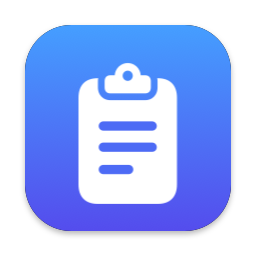

<p align="center">
  
</p>

<h1 align="center">ClipBoard</h1>

<p align="center">
  <strong>Windows-style clipboard history for your Mac.</strong><br>
  Press <kbd>⌘</kbd> <kbd>⇧</kbd> <kbd>V</kbd> anywhere to see everything you've copied — text, images, GIFs, videos and files — and paste any of it again.
</p>

<p align="center">
  <a href="https://github.com/Alawieh/MacOsClipboard/releases/latest"></a>
  
  
  <a href="LICENSE"></a>
</p>

---

## Why

Windows has <kbd>Win</kbd>+<kbd>V</kbd>: a clipboard that remembers. macOS only keeps the last thing you copied.
ClipBoard adds the missing history: free, open source, lightweight, and 100% on your Mac.

> On a Windows/PC keyboard plugged into a Mac, the Windows key acts as <kbd>⌘</kbd>, so the shortcut is literally **Win + Shift + V**.

## Features

- **Always on.** Lives in the menu bar (no Dock icon) and starts at login.
- **Remembers everything you copy:** text (with formatting), screenshots and images, animated GIFs (stay animated),
  videos, audio, and files copied in Finder.
- **Pops up where you are.** <kbd>⌘</kbd><kbd>⇧</kbd><kbd>V</kbd> opens the history right at your mouse pointer, without taking focus from the app you're typing in.
- **Pastes for you.** Pick an item and it's pasted straight into the app you were using.
- **Search** as you type, **pin** favourites so they never disappear, delete single items or clear everything.
- **Keyboard first.** <kbd>↑</kbd> <kbd>↓</kbd> <kbd>↩</kbd>, and <kbd>⌘1</kbd>–<kbd>⌘9</kbd> for instant paste.
- **Private.** No network access, no accounts, no analytics. Passwords copied from password managers are skipped.
- **Survives restarts.** History is saved on disk (last 100 items + everything you pin).

## Install

### Option 1 — Download the installer (easiest)

1. Download **`ClipBoard-x.y.z.dmg`** from the [latest release](https://github.com/Alawieh/MacOsClipboard/releases/latest).
2. Open it and drag **ClipBoard** onto the **Applications** folder.
3. Open **ClipBoard** from Applications.

**The first time only**, macOS will say it *"could not verify"* ClipBoard. That's because the app isn't notarized
(notarization requires a paid Apple Developer account; the full source is right here for you to check). To allow it:

1. Click **Done** on that message.
2. Open **System Settings → Privacy & Security**, scroll down, and click **Open Anyway** next to *"ClipBoard was blocked"*.
3. Confirm with your password. You won't be asked again.

### Option 2 — One line in Terminal

Downloads the latest release, installs it in Applications and opens it (no "could not verify" step):

```bash
curl -fsSL https://raw.githubusercontent.com/Alawieh/MacOsClipboard/main/scripts/get.sh | bash
```

### Option 3 — Build from source

Requires Xcode 26 or newer.

```bash
git clone https://github.com/Alawieh/MacOsClipboard.git
cd MacOsClipboard
scripts/install.sh
```

This builds a Release copy, puts it in `/Applications` and opens it.

## First run

- A clipboard icon appears in the **menu bar**. ClipBoard turns on **Launch at Login** by itself the first time it runs
  from Applications (you can switch it off in that menu).
- The first time you paste, macOS asks to give ClipBoard **Accessibility** access. That's what lets it press
  <kbd>⌘</kbd><kbd>V</kbd> for you in the app you're using: **System Settings → Privacy & Security → Accessibility → ClipBoard ✓**.
  Without it, ClipBoard still works: picked items go on the clipboard and you press <kbd>⌘</kbd><kbd>V</kbd> yourself.

## How to use

| Keys | Action |
| --- | --- |
| <kbd>⌘</kbd> <kbd>⇧</kbd> <kbd>V</kbd> | Open / close the clipboard history |
| Type anything | Search |
| <kbd>↑</kbd> <kbd>↓</kbd> | Move the selection |
| <kbd>↩</kbd> or click | Paste the selected item |
| <kbd>⌘</kbd> <kbd>1</kbd> … <kbd>⌘</kbd> <kbd>9</kbd> | Paste item 1–9 instantly |
| <kbd>⌘</kbd> <kbd>P</kbd> | Pin / unpin (pinned items stay on top and are never cleared) |
| <kbd>⌘</kbd> <kbd>⌫</kbd> | Delete the selected item |
| <kbd>Esc</kbd> or click outside | Close |

The menu-bar icon has: Open Clipboard, Launch at Login, Enable Auto-Paste, Clear History, Quit.

## Privacy

- Everything stays on your Mac, in `~/Library/Application Support/ClipBoard/`. ClipBoard never connects to the internet.
- Copies that password managers mark as secret ([nspasteboard.org](http://nspasteboard.org) convention, used by 1Password,
  Bitwarden, KeePassXC and others) are never recorded.
- Files copied in Finder are remembered by their location only. ClipBoard never opens, reads or scans your folders,
  so it never asks for access to Desktop, Documents or Downloads.

## FAQ

**<kbd>⌘</kbd><kbd>⇧</kbd><kbd>V</kbd> used to be "Paste and Match Style". Is that gone?**
While ClipBoard runs, it owns that shortcut. You can still use *Edit → Paste and Match Style* (or <kbd>⌥</kbd><kbd>⇧</kbd><kbd>⌘</kbd><kbd>V</kbd> in most apps).

**Nothing happens when I press <kbd>⌘</kbd><kbd>⇧</kbd><kbd>V</kbd>.**
Another app may already use that shortcut. Use **Open Clipboard** from the menu-bar icon, and quit the other app or change its shortcut.

**Auto-paste stopped working after I updated ClipBoard.**
macOS ties the Accessibility permission to the exact app build. In **System Settings → Privacy & Security → Accessibility**,
remove ClipBoard with **−**, then paste once more and allow it again.

**How do I uninstall?**
Quit ClipBoard from its menu, delete it from Applications, and (optionally) delete
`~/Library/Application Support/ClipBoard` to remove your history.

## For developers

ClipBoard is a native SwiftUI + AppKit app (Swift 6, MVVM), with no third-party dependencies.

```
ClipBoard/
  Models/        ClipItem, ClipContent
  Persistence/   ClipHistoryStore (history.json + media files), SettingsStore
  Services/      Pasteboard reader/writer/monitor, paste (⌘V), global hot key, login item, thumbnails
  ViewModels/    ClipboardPanelViewModel, MenuBarViewModel
  Views/         The floating panel, rows, menu-bar menu
ClipBoardUnitTests/   Swift Testing suites
scripts/              audit.sh (build + tests), install.sh, release.sh (builds the .dmg), get.sh
```

- **Open** `ClipBoard.xcodeproj` and press Run. It builds with "Sign to Run Locally", so no Apple account is needed.
  Optional: copy `Config/Local.xcconfig.example` to `Config/Local.xcconfig` and add your team ID; with a stable signature
  macOS keeps the Accessibility permission across rebuilds.
- **Test:** `scripts/audit.sh gate` builds with warnings as errors, runs the unit tests and checks coverage.
  Reports go to `build/audit/`.
- **Package:** `scripts/release.sh` runs the audit and produces `build/release/ClipBoard-<version>.dmg`.

Issues and pull requests are welcome. Please run `scripts/audit.sh gate` before opening a PR.

## License

[MIT](LICENSE) © 2026 Hussien Alawieh
